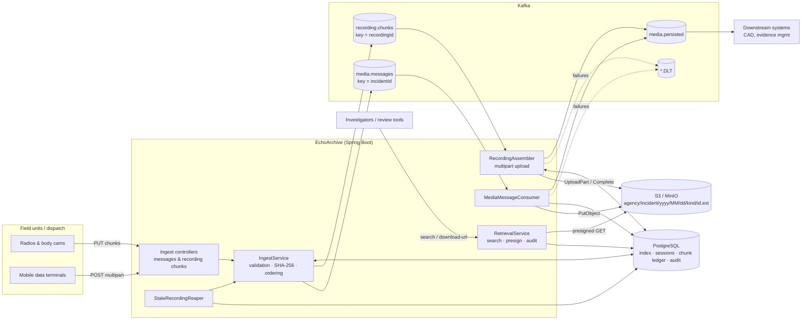
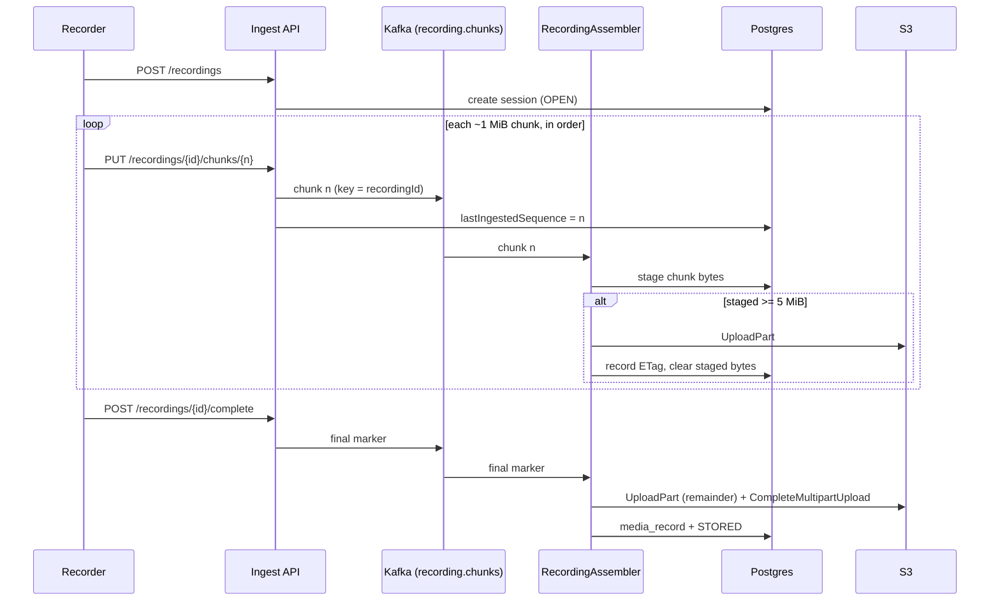

# EchoArchive

A backend service for mission-critical multimedia messaging and call recording, built for
public-safety teams. Field units upload photos, video clips, voice notes and streamed call audio;
EchoArchive routes everything through **Kafka** and persists it to **S3** (AWS in the cloud, or an
S3-compatible store such as MinIO on-prem), so it can be retrieved after an incident with a full
audit trail.

**Stack:** Java 21 · Spring Boot 3.3 · Spring Kafka · AWS SDK v2 (S3) · Spring Data JPA + Flyway
(PostgreSQL) · Testcontainers

## What it does

- **Multimedia messages:** `POST /api/v1/messages` (multipart, up to 5 MiB). The response is
  `202 Accepted` only after Kafka has acknowledged the write (`acks=all`, idempotent producer), so a
  success response means the media is durable even if storage is down.
- **Streamed call recordings:** start a session, `PUT` ordered audio chunks, then complete. Chunks
  are folded into an **S3 multipart upload**. Partial parts are staged in the database so a consumer
  crash loses nothing. Recordings from recorders that go silent are completed automatically, so the
  partial audio is still kept.
- **Chain of custody:** SHA-256 checked at ingest and again before storage, stored as object
  metadata and in the index. Recordings carry a hash over the ordered chunk hashes, and a
  per-chunk ledger is kept.
- **Post-incident retrieval:** search by agency, incident, sender, kind, priority and time window;
  incident timelines; short-lived **presigned download URLs**. Every access is written to an
  audit log.
- **Resilience:** per-incident and per-call ordering through Kafka keys, idempotent consumers,
  exponential backoff retries, dead-letter topics, an S3 health indicator and a gauge for stuck
  recordings.
- **Cloud or on-prem:** same build, selected by Spring profile (`cloud` = AWS S3 with the default
  credential chain; `onprem` = MinIO endpoint with path-style access).

## Architecture



### Recording flow



### Package layout

| Package | Responsibility |
|---|---|
| `config` | Typed properties, Kafka topics/producer/consumer factories, S3 client |
| `domain` | Kafka event records and enums |
| `ingest` | REST ingest, validation, Kafka publishing |
| `consume` | Kafka listeners, recording assembly, persisted-event publishing |
| `storage` | `ObjectStore` over S3, key layout, health indicator |
| `metadata` | JPA entities and repositories |
| `retrieval` | Search, incident timeline, presigned downloads |
| `audit` | Append-only access log |
| `maintenance` | Scheduled salvage of silent recordings |

## Running locally

Prerequisites: JDK 21, Maven 3.9+, Docker.

```bash
cp .env.example .env               # set DB_PASSWORD, S3_ACCESS_KEY, S3_SECRET_KEY
docker compose --env-file .env up -d   # Kafka (KRaft), Postgres, MinIO

set -a; source .env; set +a
mvn spring-boot:run                # profile defaults to "onprem"
```

The app creates its Kafka topics and (on-prem) the MinIO bucket on startup, and Flyway sets up the
schema. The MinIO console is at http://localhost:9001.

### Deploying to AWS

Run with `SPRING_PROFILES_ACTIVE=cloud`. Leave `S3_ENDPOINT`, `S3_ACCESS_KEY` and `S3_SECRET_KEY`
unset; credentials come from the default AWS provider chain (instance profile, IRSA or env vars).
The bucket must already exist. A lifecycle rule to abort incomplete multipart uploads after a few
days is recommended. Point `KAFKA_BOOTSTRAP_SERVERS` at MSK (or any Kafka) and `DB_URL` at RDS.

A container image can be built with `docker build -t echoarchive .`.

### Example calls

```bash
# Upload a photo
curl -F file=@scene.jpg -F agency=metro-fd -F incidentId=INC-1001 \
     -F senderId=engine-12 -F priority=EMERGENCY \
     http://localhost:8080/api/v1/messages

# Stream a call recording
curl -X POST -H 'Content-Type: application/json' \
     -d '{"recordingId":"rec-1","agency":"metro-pd","incidentId":"INC-1001","callId":"call-9","contentType":"audio/ogg"}' \
     http://localhost:8080/api/v1/recordings
curl -X PUT -H 'Content-Type: application/octet-stream' --data-binary @chunk0.ogg \
     http://localhost:8080/api/v1/recordings/rec-1/chunks/0
curl -X POST -H 'Content-Type: application/json' -d '{"expectedChunks":1}' \
     http://localhost:8080/api/v1/recordings/rec-1/complete
curl http://localhost:8080/api/v1/recordings/rec-1

# Retrieve
curl -H 'X-Actor: sgt.lee' 'http://localhost:8080/api/v1/media?incidentId=INC-1001&minPriority=URGENT'
curl -H 'X-Actor: sgt.lee' http://localhost:8080/api/v1/incidents/INC-1001
curl -H 'X-Actor: sgt.lee' http://localhost:8080/api/v1/media/rec-1/download-url
curl http://localhost:8080/api/v1/incidents/INC-1001/audit
```

`X-Actor` identifies the caller for the audit log. In production it should be set by the
authenticating gateway, not by the client.

### Endpoints

| Method | Path | Purpose |
|---|---|---|
| POST | `/api/v1/messages` | Upload a multimedia message (multipart) |
| POST | `/api/v1/recordings` | Start a recording session |
| PUT | `/api/v1/recordings/{id}/chunks/{seq}` | Append an ordered audio chunk (`X-Content-SHA256` optional) |
| POST | `/api/v1/recordings/{id}/complete` | Finish a recording |
| GET | `/api/v1/recordings/{id}` | Recording status |
| GET | `/api/v1/media` | Search the archive |
| GET | `/api/v1/media/{id}` | Media metadata |
| GET | `/api/v1/media/{id}/download-url` | Presigned download link |
| GET | `/api/v1/incidents/{id}` | Incident timeline |
| GET | `/api/v1/incidents/{id}/audit` | Access log for an incident |
| GET | `/actuator/health` | Health (includes object store) |

## Testing

```bash
mvn test      # unit + slice tests (no Docker needed; H2 in PostgreSQL mode)
mvn verify    # also runs EchoArchivePipelineIT (Testcontainers: Kafka + MinIO, needs Docker)
```

- `ObjectKeyBuilderTest`, `ChecksumsTest`: key layout and checksum helpers
- `IngestServiceTest`: validation, idempotent chunk retries, ordering, completion
- `IngestControllerTest`: HTTP status mapping (202/400/409/503)
- `RecordingAssemblerTest`: multipart assembly against an in-memory S3 that enforces the 5 MiB
  minimum part size; duplicates, gaps and corrupt chunks
- `RetrievalServiceTest`: presigned links and auditing
- `EchoArchivePipelineIT`: full REST -> Kafka -> MinIO -> presigned download round trip, and a
  chunked recording assembled into one object

## Configuration

| Property | Default | Notes |
|---|---|---|
| `echoarchive.ingest.max-message-bytes` | 5 MiB | Larger media should be sent as a chunked recording |
| `echoarchive.ingest.max-chunk-bytes` | 1 MiB | Per recording chunk |
| `echoarchive.ingest.multipart-part-bytes` | 5 MiB | S3 minimum part size |
| `echoarchive.retrieval.presign-ttl` | 15m | Download link lifetime |
| `echoarchive.retrieval.stale-upload-after` | 2h | Silence before a recording is salvaged |
| `echoarchive.topics.partitions` | 6 | Per topic |
